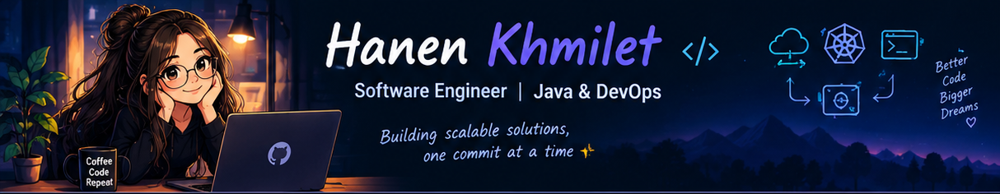
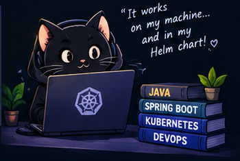
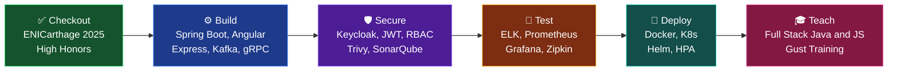

  

<!-- ABOUT -->
<table>
  <tr>
    <td valign="top" width="50%">
      <h2>💻 About Me</h2>
      

        I'm a <b>Software Engineer</b> passionate about building useful things, solving tricky problems and occasionally wondering why the code worked five minutes ago.
        I specialize in <b>Full Stack Java/Angular</b>, microservices, and DevOps. I care about clean code, security, observability and resilient systems, and I love sharing what I learn through teaching. 💜
      

    </td>
    <td valign="top" width="30%">
      
🎓 Software Engineering graduate (ENICarthage · 2025 · High Honors)

      
☕ Powered by coffee, curiosity and Stack Overflow

      
🎯 Currently building my skills in cloud, microservices and distributed systems

      
⭐ Fun fact: my code has fewer bugs than my sleep schedule. Probably. 👀

    </td>
    <td valign="middle" width="20%">
      
    </td>
  </tr>
</table>

  
  
  

<!-- TECH STACK + FEATURED PROJECTS -->
<table>
  <tr>
    <td valign="top" width="50%">
      <h2>🔧 Tech Stack</h2>
<b>🧑‍💻 Languages</b> 

  
<b>⚙️ Backend & Communication</b> 

  
<b>🖥️ Frontend</b> 
  
<b>🛡️ Security</b> 

  
<b>🗄️ Data</b> 

  
<b>☁️ DevOps, Cloud & Observability</b> 

  
    </td>
    <td valign="top" width="50%">
      <h2>🚀 Featured Projects</h2>
<b>🛡️ AppGuard</b> (End-of-studies project) 
Supervision system for client applications and Cron Jobs: real-time logs, metrics and alerting, JWT/RBAC security, Redis caching and Ansible automation. 

  
<b>👥 PlateformRH</b> (Microservices HR platform) 
Migrated a monolith to autonomous services: gRPC + Kafka, Keycloak RBAC, CV analysis with a local LLM (Spring AI + Ollama), Kubernetes/Helm deployment, full observability. 

  
<b>💼 <a href="https://github.com/hanen-kh/GestionRH">GestionRH</a></b> (HR management API) 
Secured CI/CD pipeline: build, test, Sonar, Trivy, Docker push. 

  
<i>More projects coming soon...</i>
    </td>
  </tr>
</table>

<!-- CI/CD PIPELINE -->
## 🧬 CI/CD Pipeline (Jenkinsfile)

<i>Still learning. The pipeline never really finishes. ✨</i>

<!-- STATS -->
## 📊 GitHub Stats

  
  

<!-- CONNECT -->
## ✈️ Let's Connect

  
  

<i>Happy to talk about Java, microservices, DevOps, teaching, or why the build is red. 🔴➡️🟢</i>

<!-- TODO: replace YOUR-LINKEDIN and YOUR-EMAIL -->
